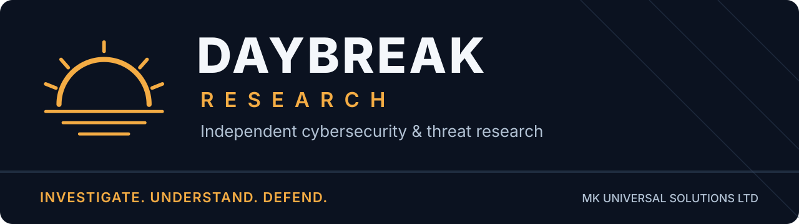

# DAYBREAK RESEARCH

[English](#english) · [Polski](#polski)

## English

Independent cybersecurity research by **MK Universal Solutions Ltd**: malware analysis, reverse engineering, digital forensics, threat intelligence and defensive security research.

### Publications

| ID | Research report | Editions |
| --- | --- | --- |
| DB-2026-001 | ClickFix on macOS: data collection begins before the password is entered | [English](publications/DB-2026-001/en/README.md) · [Polski](publications/DB-2026-001/README.md) |

DB-2026-001 · DAYBREAK BLUE · English edition 1.0.0 / Polish edition 1.0.0 · bilingual package v1.1.0.

[Technical report](publications/DB-2026-001/en/report.md) · [Evidence matrix](publications/DB-2026-001/en/evidence.md) · [Indicators](publications/DB-2026-001/en/indicators.md) · [Figures](publications/DB-2026-001/en/figures/README.md)

We separate static observations, recorded execution events, examination of preserved artefacts and hypotheses. See the [evidence standard](methodology/evidence-standard.en.md). The repository contains defensive materials, not executable samples, credentials or unredacted victim data. See [reporting corrections](SECURITY.md#english).

## Polski

Niezależne badania cyberbezpieczeństwa MK Universal Solutions Ltd: analiza złośliwego oprogramowania, inżynieria odwrotna, informatyka śledcza, threat intelligence i ochrona systemów.

### Publikacje

| Identyfikator | Temat | Język |
| --- | --- | --- |
| DB-2026-001 | ClickFix na macOS: zbieranie danych zaczyna się przed podaniem hasła | [Polski](publications/DB-2026-001/README.md) · [English](publications/DB-2026-001/en/README.md) |

[Raport techniczny](publications/DB-2026-001/pl/report.md) · [Matryca dowodowa](publications/DB-2026-001/evidence/README.md) · [IOC](publications/DB-2026-001/indicators/README.md) · [Diagramy](publications/DB-2026-001/figures/README.md)

Rozdzielamy obserwacje statyczne, zdarzenia wykonania, analizę zabezpieczonych artefaktów i hipotezy. Szczegóły: [metodyka](methodology/evidence-standard.md). Repozytorium zawiera materiały defensywne, nie próbki wykonywalne, poświadczenia ani niezredagowane dane ofiar. [Zgłaszanie korekt](SECURITY.md).

---

Publisher / Wydawca: **MK Universal Solutions Ltd** · [mkus.co.uk](https://mkus.co.uk)

Research documentation / Dokumentacja: [CC BY 4.0](LICENSE) · [Rights and citation / Prawa i cytowanie](NOTICE.md) · [Brand / Identyfikacja wizualna](assets/brand/README.md).
