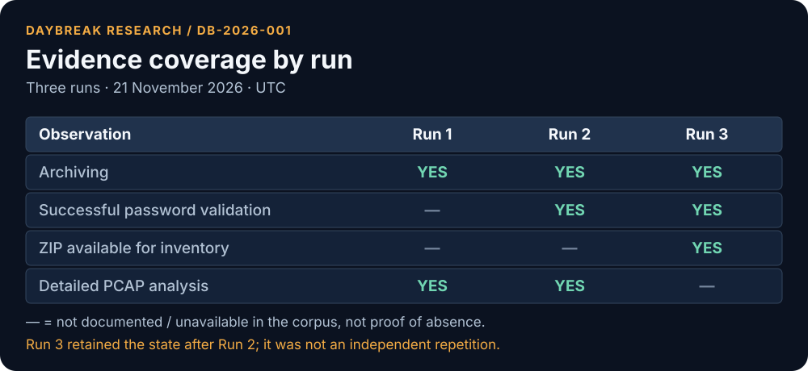
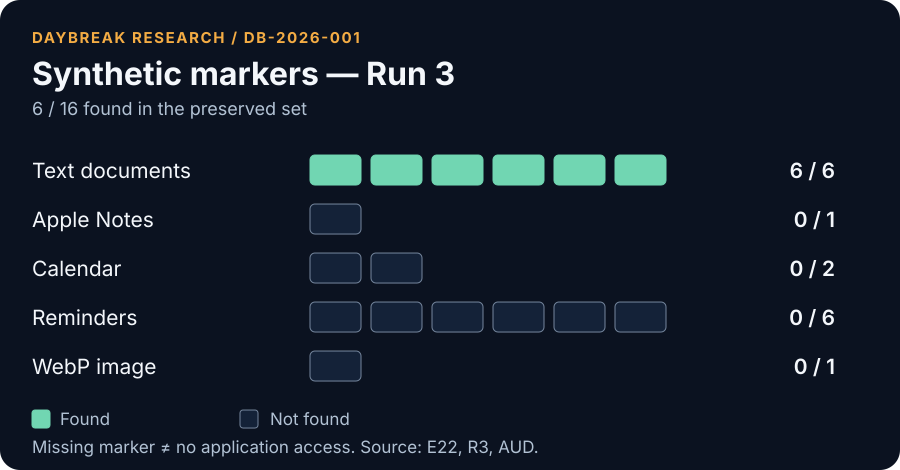
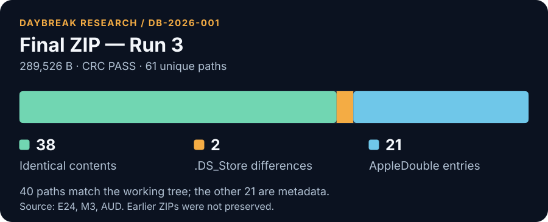
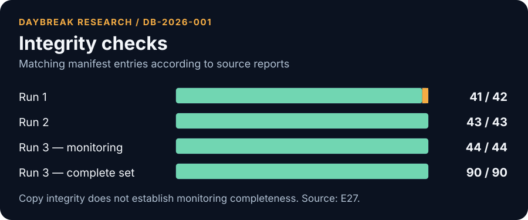

# ClickFix on macOS: data collection begins before the password is entered

**DAYBREAK RESEARCH · DB-2026-001 · research codename DAYBREAK BLUE**  
**Author:** Michal Kurzdym  
**Publisher:** MK Universal Solutions Ltd  
**Research:** 18–21 November 2026 · all times UTC  
**English edition:** 1.0.0 · bilingual repository package v1.1.0 · based on Polish v1.0.0 (25 November 2026)  
**Documentation licence:** [CC BY 4.0](../../../LICENSE)

[Original Polish edition](../pl/report.md) · [Evidence matrix](evidence.md) · [IOC data](indicators.md) · [References](references.md) · [Methodology](../../../methodology/evidence-standard.en.md)

## Executive summary

The multi-stage macOS infostealer under investigation prepared local copies of data and ZIP archives before the user's password was successfully validated. This is supported by events recorded in Run 1 and Run 2. Run 3 enabled examination of the preserved final ZIP, which contained, among other items, Apple Notes, Safari and Keychain files and six synthetic documents. Consistent file, process and static-analysis evidence indicates probable reuse of a stored credential in Run 3. Direct transfer of that value into the validation process was not established.

According to the operator's journal, the laboratory's WAN uplink was physically disconnected. Packet captures from Run 1 and Run 2 document connection attempts without TCP establishment for the observed address. Successful external transfer during the experiments was not confirmed; detailed analysis of the Run 3 packet captures is outside the scope of this report. The separate production incident on 9 November does not establish receipt of data by the server.

### Key findings

| Finding | Evidential scope |
| --- | --- |
| Data collection and initial archive before successful password validation | **CONFIRMED**, Runs 1–2 |
| Reuse of a stored credential | **PROBABLE**, Run 3; direct flow of the value not documented |
| Apple Notes database files in the preserved ZIP | **CONFIRMED**, Run 3; record contents UNKNOWN |
| AppleScript execution within Mach-O | **CONFIRMED** static capability; **PROBABLE** execution in Runs 1–2 |
| Transfer to an external recipient | **UNKNOWN** in the production incident; no confirmed delivery in the laboratory |

## 1. Scope and methodology

The research covers static analysis of Stages 1–3 and three dynamic runs of Stage 3 on 21 November 2026. The Stage 3 file under investigation was obtained directly from the address identified in Stage 2. Equivalence to the server response during execution of the complete chain was not established.

Experiments used a physical Intel MacBook Pro running macOS Big Sur 11.7.11, a dedicated SSD and a test account. Recording covered ProcessMonitor, FileMonitor, Unified Log and PCAP. Synthetic data were prepared, and selected monitoring functions were tested. Run 3 retained the state after Run 2 and was therefore not an independent repetition from the initial state. Only static analysis is available for arm64.

Time normalisation: in Run 1 the normalised Unified Log was empty; the analyst converted UTC−08:00 timestamps from the raw log. The Run 2 report documents 1,911 normalised UTC records and one truncated final ProcessMonitor record. Recorder control tests do not establish complete observability of all sample activity. (R1, R2, R3, N §22–27)

CONFIRMED, PROBABLE and UNKNOWN have the meanings set out in the [evidence standard](../../../methodology/evidence-standard.en.md). Identifiers E01–E28 and source abbreviations are explained in the [annex](evidence.md). The public report draws on project reports and manifests, not a new examination of binaries or raw telemetry.

## 2. Campaign observations and static analysis

ClickFix uses social engineering to persuade users to execute a command themselves under the pretext of verification or diagnostics. On 18–19 November, different instructions were observed for Windows and macOS users. This analysis concerns macOS.

| Stage | Finding | Status |
| --- | --- | --- |
| Stage 1 | 3,246 B script; apparent diagnostics; next stage recovered statically. | CONFIRMED, static |
| Stage 2 | 1,755 B script, communication targets and preparation of a subsequent executable. | CONFIRMED, static; telemetry purpose PROBABLE |
| Stage 3 | 5,218,432 B universal x86_64/arm64 Mach-O, ad hoc signature. | CONFIRMED, direct acquisition |
| Further components | References to additional archives identified in the code. | UNKNOWN, execution of Stage 4 |

Ghidra analysis identified dynamic hash-based API resolution (48/53 recognised), environmental checks, and separate encrypted configuration and compiled OSA data blocks. Static reconstruction revealed two OSA buffers of 298 B and 1,414,604 B. The code indicates the capability to execute scripts within the Mach-O process. No separate osascript process was observed in Run 1 or Run 2; together with static findings and AppleEvents observations, this supports a PROBABLE assessment of in-process execution. Exact dispatch and the behaviour of all branches remain UNKNOWN. (E04–E10)

### Static reconstruction findings and limitations

| Area | Finding according to S3 | Limit of inference |
| --- | --- | --- |
| x86_64 configuration | 9/9 authentication tags verified. | Complete mapping to consumers not established. |
| Small OSA buffer | 298 B of recovered compiled data. | Exact semantics and dispatch remain UNKNOWN. |
| Large OSA buffer | 1,414,604 B of recovered data; integrity check consistent with the validator described in the report. | Execution of every identified procedure was not demonstrated. |

Static analysis and runtime observations are distinct evidential bases. We do not publish recovered code, cryptographic material or reconstruction procedures that would enable reproduction of the payload.

## 3. Dynamic analysis

| Run | Principal events | Limits of evidence |
| --- | --- | --- |
| Run 1 | Started 16:35:21; initial archive and transfer attempts before password entry. | Monitoring until 16:36:46; no preserved ZIP or exit event. |
| Run 2 | Started 18:04:23; first archive 18:04:28; successful validation 18:09:55; further archiving, clean-up and termination 18:19:24. | No final ZIP for inventory; final process record partially truncated. |
| Run 3 | Retained Run 2 state; three successful archiving operations, credential artefact and validation observations, final ZIP recovered. | One preserved ZIP; no complete PCAP analysis. |

CONFIRMED: in Runs 1 and 2, collection and archiving began before successful password validation. Credential storage in Run 2 is documented; in Run 3 the artefact was read and a successful check occurred within the same second. Identical hashes of preserved copies and the operator's report of no further dialog support a PROBABLE assessment of reuse. Direct byte flow was not established. Successful password validation does not automatically establish privilege elevation or decryption of stores. (E11–E19)

### Authentication and limits of inference

In Run 2, two account checks failed at 18:08:58; a successful check and writing of the credential artefact were recorded at 18:09:55. The recorder captured the laboratory password in process arguments; neither its value nor its hash is published. AppleEvents/TCC events associated with Finder were recorded from 18:13:44. Attribution of the reported dialog to a specific procedure remains PROBABLE.

In Run 3, a successful check and opening/closing of the preserved artefact occurred at 19:55:28. Matching credential artefact hashes between Runs 2 and 3 establish consistency of the copies, not the flow of the value. The manifest also identifies a working file with identical length and SHA-256 whose path appears in the ZIP. A separate state artefact was written before password validation; its subsequent consumer remains unidentified. (R2, AUTH, POST, R3, M2, M3, AUD; E13–E19)

### Comparison of runs

| Observation | Run 1 | Run 2 | Run 3 |
| --- | --- | --- | --- |
| Local archiving events | Yes | Yes | Yes |
| Successful credential validation | Not documented | Yes | Yes |
| Preserved ZIP for inventory | No | No | Yes |
| Detailed PCAP analysis | Yes | Yes | Not in the available corpus |
| State after previous run | Not applicable | After restoration, according to journal | Retained after Run 2 |

“Not documented” does not establish that an event did not occur outside the recording window.

## 4. Digital forensics: scope of data

| Category | Documented finding |
| --- | --- |
| Apple Notes | Run 3: NoteStore.sqlite (241,664 B), WAL (160,712 B), SHM (32,768 B), all in the final ZIP. State of individual records UNKNOWN. |
| Safari and Keychain | Preserved history, cookie and keychain database files; access to protected records UNKNOWN. |
| Telegram and configurations | Writes of selected artefacts in Run 2; Run 3 also contains shell history and authorized_keys files. |
| Wallets and password managers | Static targets and selected Run 2 paths; acquisition of protected secrets UNKNOWN. |
| Documents | Six synthetic documents with confirmed matching sizes and hashes. |

### Synthetic markers (Run 3)

| Type | Prepared | Found |
| --- | ---: | ---: |
| Text documents | 6 | 6 |
| Apple Notes | 1 | 0 |
| Calendar | 2 | 0 |
| Reminders | 6 | 0 |
| WebP image | 1 | 0 |
| Total | 16 | 6 |

The 6/16 result is the number of logical markers found in the preserved set, not a measure of data theft effectiveness. Nine application-object markers were absent from the analysed set; the tenth missing marker concerns the image. Failure to find the Notes marker does not contradict the separately confirmed copy of the database files. The audit did not query the structure of application databases. The image identifier was retained in the manifest, but the file was not found in the searched copies. This is not evidence that the specific object was never accessed.

### Preserved archive

Final Run 3 ZIP: **289,526 B**, CRC PASS, 61 unique paths. After root directory normalisation, 40 paths corresponded to the preserved working tree; 38 files were byte-identical, and two differed in Finder metadata (.DS_Store). The remaining 21 entries were AppleDouble metadata. Finder writes are a probable explanation of the differences. Separate copies of earlier ZIP versions were not preserved. (E20–E24)

### Post-execution state

Post-Run 2 inspection (19:06–19:08 UTC) confirmed residual profile artefacts and two empty directories. No active Stage 3 or matching entries in the inspected autostart locations were identified. This was not an exhaustive audit of all possible persistence mechanisms. After Run 3, the operator reported restoration of state followed by a clean installation; the final audit concerned preserved copies. (POST, N, AUD)

## 5. Network communication and isolation

Process telemetry from Run 1 and Run 2 shows communication and archive transfer attempts. Packet captures contain 59 and 124 outbound SYN packets respectively (including retransmissions) to the observed IPv4 address on port 80, without TCP establishment for that destination. Run 2 also records an HTTPS attempt at process level. This is not evidence of delivery of a request or file.

According to the operator's journal, WAN access was physically disconnected. Recorded Run 1 and Run 2 traffic is consistent with the isolation configuration. Server behaviour with WAN access remains undetermined. (E25–E26)

## 6. Separate production incident: 9 November 2026

The audit recorded changes to DNS and five redirect rules across two Cloudflare accounts on 8 November; the owner described them as unauthorised. Two ClickFix runs were identified on 9 November at approximately 00:42 and 00:43–00:44. Unlike the subsequently analysed sample, the historical chain used a separate osascript process and Python module.

The preserved ZIP contained 58,109,740 B and 115 files. Inventory identified 2,315 Chrome records with non-empty encrypted password fields, 1,781 autofill records and 499 cookie records, as well as Keychain and Telegram artefacts. These are category counts, not evidence of decryption. Two probable transfer attempts do not establish receipt. No causal relationship with the redirects or common operator of the two cases was established. (E01–E03, E28)

## 7. Defence and incident response

- Correlate ClickFix social engineering with unusual shell activity, execution of a new file, serial access to data stores and local archiving.
- Detect collection before a password dialog; consider OSA/AppleEvents telemetry and do not make detection dependent on the presence of an osascript process.
- Combine endpoint telemetry with DNS, proxy and firewall data. Indicators are historical; an individual domain or filename alone does not establish compromise.
- Following suspicious execution, isolate the host, preserve relevant evidence, assess possible exposure and use a trusted device to change potentially compromised credentials and revoke relevant sessions and tokens.
- Keep macOS updated, limit excessive permissions and educate users about fraudulent verification prompts.

[IOC CSV](IOC.csv) and [IOC JSON](IOC.json) are intended for defensive correlation only.

### MITRE ATT&CK mapping

The following mapping is a defensive interpretation, not additional evidence or attribution of the operator.

| Technique | Relationship to DAYBREAK findings |
| --- | --- |
| [T1204.004 — Malicious Copy and Paste](https://attack.mitre.org/techniques/T1204/004/) | Observed ClickFix social engineering mechanism; the complete campaign chain was not reproduced dynamically. |
| [T1059.002 — AppleScript](https://attack.mitre.org/techniques/T1059/002/) | Statically confirmed OSA execution capability, probable in-process execution in Runs 1–2. |
| [T1560.001 — Archive via Utility](https://attack.mitre.org/techniques/T1560/001/) | Documented local archiving. |
| [T1555.001 — Keychain](https://attack.mitre.org/techniques/T1555/001/) | Documented copying of store files; extraction of all protected credentials not confirmed. |

External context, defensive recommendations and platform documentation are collected in the [bibliography](references.md). We do not attribute the sample to the campaign described by Microsoft solely on the basis of similar techniques.

## 8. Integrity, limitations and attribution

Run 1: 41/42 matching manifest entries (Stage 3 copy missing). Run 2: 43/43 internal manifest entries; M2 covers 373 paths in the wider copy. Run 3: 44/44 monitoring entries and 90/90 entries of the complete set according to the audit; 40 working directory files, 4,168,960 B. Matching hashes establish copy integrity within the scope of checking, not completeness of monitoring. (E27)

Reported SHA-256 of the final Run 3 ZIP: `b2bc3a974f2c24c3008739868ae0699b4cae6440746ea9785d7ece59ea193f99`. Reported SHA-256 of manifest M3: `b463f99df303d6f59c41bc1a15a1c0a512c510e3c35354bb1cfcb8edeec7aa29`. These values identify private artefacts and do not permit independent verification without access to the files. They were not recalculated during editorial revision 0.9.1. (M3, AUD)

Limitations: one Intel host and one macOS version, arm64 static analysis without dynamic analysis, incomplete Run 1 recording, truncated Run 2 record, no complete Run 3 PCAP analysis, missing earlier ZIP versions and no independent audit of raw materials during this editorial stage. The specific family, variant and operator were not established. Observations are consistent with the macOS infostealer class; a heuristic antivirus label suggesting AMOS is not sufficient evidence of attribution on its own. (E28)

## 9. Conclusions

Not entering a password does not rule out prior collection of local data. Detection should rely on behavioural correlation independently of the appearance of a dialog and success of transfer. The experiments do not establish universal sample effectiveness across macOS configurations or delivery of data in a production network.

## Evidence availability

According to the operator, original samples, logs, packet captures, artefacts and manifests remain in a separate secured archive. This publication presents redacted results and does not enable complete independent reproduction. It does not contain active malware, actual credentials or private links. [Evidence annex](evidence.md).
