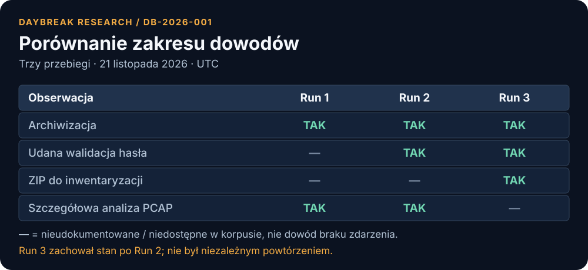
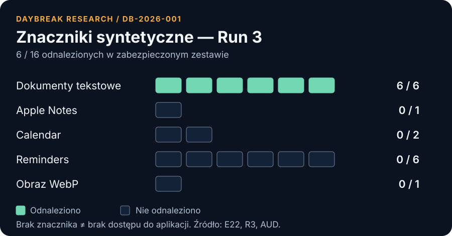
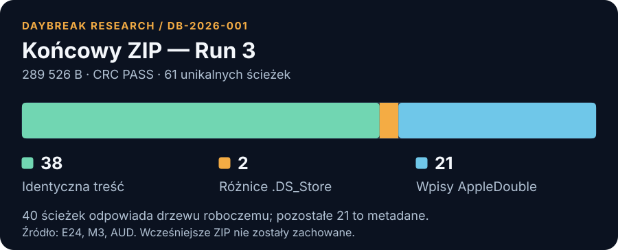
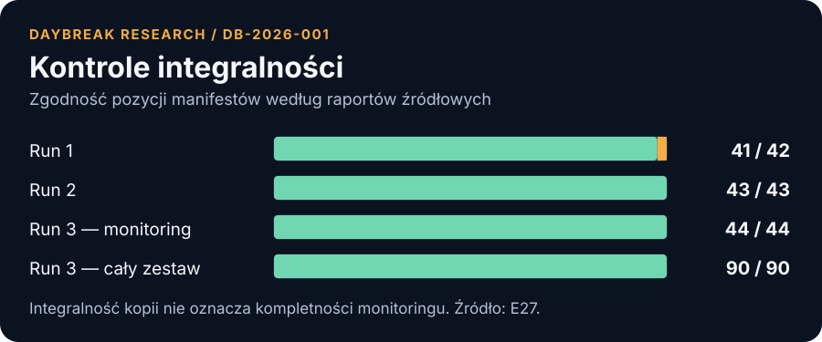

# ClickFix na macOS: zbieranie danych zaczyna się przed podaniem hasła

**DAYBREAK RESEARCH · DB-2026-001 · kryptonim DAYBREAK BLUE**  
**Wydawca:** MK Universal Solutions Ltd  
**Badanie:** 18–21 listopada 2026 · wszystkie czasy UTC  
**Wersja:** 0.9.2 — do recenzji publikacyjnej

[Matryca ustaleń](../evidence/README.md) · [IOC](../indicators/README.md) · [Bibliografia](references.md) · [Metodyka](../../../methodology/evidence-standard.md)

## Streszczenie

Badany wieloetapowy infostealer dla macOS przygotowywał lokalne kopie danych i archiwa ZIP jeszcze przed pomyślną weryfikacją hasła użytkownika. Potwierdzają to zdarzenia Run 1 i Run 2. Run 3 pozwolił zbadać zachowany końcowy ZIP i wykazał obecność m.in. plików Apple Notes, Safari i Keychain oraz sześciu dokumentów syntetycznych. Zgodność śladów plikowych, procesowych i statycznych wskazuje na prawdopodobne ponowne użycie zapisanego poświadczenia w Run 3. Nie potwierdzono bezpośredniego przepływu wartości do procesu walidującego.

Laboratorium miało fizycznie odłączone wyjście WAN według dziennika operatora. PCAP z Run 1 i Run 2 dokumentują próby połączeń bez zestawienia TCP dla obserwowanego adresu. Nie ma potwierdzenia skutecznego transferu zewnętrznego podczas eksperymentów; szczegółowa analiza PCAP Run 3 pozostaje poza zakresem opracowania. Odrębny incydent produkcyjny z 9 listopada nie rozstrzyga odbioru danych przez serwer.

### Najważniejsze wyniki

| Wynik | Zakres pewności |
| --- | --- |
| Zebranie danych i pierwsze archiwum przed pomyślną walidacją hasła | **CONFIRMED**, Run 1–2 |
| Ponowne użycie zapisanego poświadczenia | **PROBABLE**, Run 3; bezpośredni przepływ wartości nieudokumentowany |
| Pliki bazy Apple Notes w zachowanym ZIP | **CONFIRMED**, Run 3; zawartość rekordów UNKNOWN |
| Wykonanie AppleScript w obrębie Mach-O | **CONFIRMED** możliwość statyczna; **PROBABLE** wykonanie w Run 1–2 |
| Transfer do zewnętrznego odbiorcy | **UNKNOWN** w incydencie produkcyjnym; w laboratorium brak potwierdzenia dostarczenia |

## 1. Zakres i metodyka

Badanie obejmuje analizę statyczną Stage 1–3 i trzy przebiegi dynamiczne Stage 3 z 21 listopada 2026. Analizowany plik Stage 3 pozyskano bezpośrednio z adresu wskazanego w Stage 2. Nie potwierdzono równoważności odpowiedzi serwera przy wykonaniu całego łańcucha.

Eksperymenty przeprowadzono na fizycznym MacBooku Pro Intel z macOS Big Sur 11.7.11, dedykowanym SSD i kontem testowym. Rejestracja obejmowała ProcessMonitor, FileMonitor, Unified Log i PCAP. Przygotowano dane syntetyczne oraz wykonano próby kontrolne wybranych funkcji monitoringu. Run 3 zachował stan po Run 2, a więc nie był niezależnym powtórzeniem ze stanu początkowego. Dla arm64 dostępna jest wyłącznie analiza statyczna.

Normalizacja czasu: w Run 1 znormalizowany Unified Log był pusty; analityk przeliczył znaczniki UTC−08:00 z surowego dziennika. W Run 2 raport dokumentuje 1 911 znormalizowanych zapisów UTC oraz jeden ucięty końcowy rekord ProcessMonitor. Próby kontrolne rejestratorów nie dowodzą pełnej obserwowalności wszystkich działań próbki. (R1, R2, R3, N §22–27)

Statusy CONFIRMED, PROBABLE i UNKNOWN mają znaczenie określone w [standardzie dowodowym](../../../methodology/evidence-standard.md). Identyfikatory E01–E28 i skróty źródeł są rozwinięte w [aneksie](../evidence/README.md). Opracowanie publiczne opiera się na raportach i manifestach projektu, nie na nowym badaniu binariów lub surowej telemetrii.

## 2. Obserwacje kampanii i analiza statyczna

ClickFix wykorzystuje socjotechnikę nakłaniającą użytkownika do samodzielnego wykonania polecenia pod pozorem weryfikacji lub diagnostyki. W dniach 18–19 listopada odnotowano odmienne instrukcje prezentowane użytkownikom Windows i macOS. Niniejsza analiza dotyczy macOS.

| Etap | Wynik | Status |
| --- | --- | --- |
| Stage 1 | Skrypt 3 246 B, pozorna diagnostyka; statycznie odzyskano kolejny etap. | CONFIRMED, statycznie |
| Stage 2 | Skrypt 1 755 B, cele komunikacji i przygotowanie kolejnego pliku wykonywalnego. | CONFIRMED, statycznie; znaczenie telemetrii PROBABLE |
| Stage 3 | 5 218 432 B, uniwersalny Mach-O x86_64/arm64, podpis ad hoc. | CONFIRMED, pozyskanie bezpośrednie |
| Kolejne komponenty | W kodzie rozpoznano odwołania do dalszych archiwów. | UNKNOWN, wykonanie Stage 4 |

Analiza Ghidry wykazała dynamiczne rozwiązywanie API na podstawie hashy (rozpoznano 48/53), kontrole środowiska oraz odrębne zaszyfrowane bloki konfiguracji i skompilowanych danych OSA. Rekonstrukcja statyczna ujawniła dwa bufory OSA o wielkości 298 B i 1 414 604 B. Kod wskazuje na możliwość wykonania skryptów w obrębie Mach-O. W Run 1 i Run 2 nie zaobserwowano odrębnego procesu osascript; w połączeniu ze statyką i obserwacjami AppleEvents wspiera to ocenę PROBABLE dotyczącą wykonania wewnątrz procesu. Dokładny dispatch i zachowanie wszystkich gałęzi pozostają UNKNOWN. (E04–E10)

### Wyniki rekonstrukcji statycznej i ich ograniczenia

| Obszar | Wynik według S3 | Granica wniosku |
| --- | --- | --- |
| Konfiguracja x86_64 | 9/9 zweryfikowanych tagów uwierzytelnienia. | Nie ustalono pełnego mapowania do odbiorców. |
| Mały bufor OSA | 298 B odzyskanych danych skompilowanych. | Dokładna semantyka i dispatch pozostają UNKNOWN. |
| Duży bufor OSA | 1 414 604 B odzyskanych danych; kontrola integralności zgodna z walidatorem opisanym w raporcie. | Nie wykazano wykonania każdej rozpoznanej procedury. |

Analiza statyczna i obserwacje runtime są odrębnymi podstawami dowodu. Nie publikujemy odzyskanego kodu, materiału kryptograficznego ani procedur rekonstrukcji umożliwiających odtworzenie ładunku.

## 3. Analiza dynamiczna

| Przebieg | Najważniejsze zdarzenia | Granice dowodu |
| --- | --- | --- |
| Run 1 | Start 16:35:21, pierwsze archiwum i próby wysyłki jeszcze przed wprowadzeniem hasła. | Monitoring do 16:36:46; brak zachowanego ZIP i zdarzenia zakończenia. |
| Run 2 | Start 18:04:23, pierwsza archiwizacja 18:04:28, pomyślna walidacja 18:09:55, kolejne archiwizacje, sprzątanie i zakończenie 18:19:24. | Brak końcowego ZIP do inwentaryzacji; ostatni rekord procesowy częściowo ucięty. |
| Run 3 | Zachowany stan Run 2; trzy pomyślne operacje archiwizacji, obserwacja pliku poświadczenia i walidacji, odzysk końcowego ZIP. | Jeden zachowany ZIP; brak pełnego opracowania PCAP. |

CONFIRMED: w Run 1 i Run 2 zbieranie i pakowanie rozpoczęły się przed pomyślną walidacją hasła. Zapis poświadczenia w Run 2 jest udokumentowany; w Run 3 wystąpiły odczyt tego artefaktu i udana kontrola w tej samej sekundzie. Identyczne skróty zachowanych kopii oraz brak ponownego dialogu według operatora wspierają ocenę PROBABLE dotyczącą reużycia wartości. Nie ustalono bezpośredniego przepływu bajtów. Pomyślna kontrola hasła nie oznacza automatycznie podniesienia uprawnień ani odszyfrowania magazynów. (E11–E19)

### Uwierzytelnienie i granice wnioskowania

W Run 2 dwie kontrole konta zakończyły się niepowodzeniem o 18:08:58; udaną kontrolę i zapis artefaktu poświadczenia odnotowano o 18:09:55. Rejestrator utrwalił laboratoryjne hasło w argumentach procesu; wartość i jej skrót nie są publikowane. Od 18:13:44 odnotowano zdarzenia AppleEvents/TCC związane z Finderem. Przypisanie zgłoszonego dialogu do konkretnej procedury pozostaje PROBABLE.

W Run 3 pomyślna kontrola i otwarcie/zamknięcie zachowanego artefaktu wystąpiły o 19:55:28. Zgodność skrótów artefaktu poświadczenia między Run 2 i Run 3 stanowi dowód zgodności kopii, nie dowód przepływu wartości. Manifest wskazuje też plik roboczy o identycznej długości i SHA-256, którego ścieżkę znaleziono w ZIP. Odrębny artefakt stanu został zapisany przed walidacją hasła; jego dalszy odbiorca nie jest ustalony. (R2, AUTH, POST, R3, M2, M3, AUD; E13–E19)

### Porównanie przebiegów

| Obserwacja | Run 1 | Run 2 | Run 3 |
| --- | --- | --- | --- |
| Zdarzenia lokalnej archiwizacji | Tak | Tak | Tak |
| Udana walidacja poświadczenia | Nieudokumentowana | Tak | Tak |
| Zachowany ZIP do inwentaryzacji | Nie | Nie | Tak |
| Szczegółowe opracowanie PCAP | Tak | Tak | Nie w dostępnym korpusie |
| Stan po wcześniejszym przebiegu | Nie dotyczy | Po przywróceniu według dziennika | Zachowany po Run 2 |

„Nieudokumentowana” nie oznacza dowodu nieistnienia zdarzenia poza oknem rejestracji.

## 4. Informatyka śledcza: zakres danych

| Kategoria | Udokumentowany wynik |
| --- | --- |
| Apple Notes | Run 3: NoteStore.sqlite (241 664 B), WAL (160 712 B), SHM (32 768 B), wszystkie w końcowym ZIP. Stan konkretnych rekordów UNKNOWN. |
| Safari i Keychain | Zachowane pliki historii, cookies i baz pęku kluczy; odczyt chronionych rekordów UNKNOWN. |
| Telegram i konfiguracje | Zapisy wybranych artefaktów w Run 2; w Run 3 również pliki historii powłoki i authorized_keys. |
| Portfele i menedżery haseł | Cele statyczne i wybrane ścieżki Run 2; pozyskanie chronionych sekretów UNKNOWN. |
| Dokumenty | Sześć syntetycznych dokumentów z potwierdzoną zgodnością rozmiarów i hashy. |

### Znaczniki syntetyczne (Run 3)

| Typ | Przygotowano | Odnaleziono |
| --- | ---: | ---: |
| Dokumenty tekstowe | 6 | 6 |
| Apple Notes | 1 | 0 |
| Calendar | 2 | 0 |
| Reminders | 6 | 0 |
| Obraz WebP | 1 | 0 |
| Razem | 16 | 6 |

Wynik 6/16 to liczba logicznych znaczników odnalezionych w zabezpieczonym zestawie, a nie wskaźnik skuteczności kradzieży danych. Dziewięć markerów obiektów aplikacyjnych nie wystąpiło w analizowanym zestawie; dziesiąty brak dotyczy obrazu. Nieodnalezienie markera Notes nie przeczy niezależnie potwierdzonej kopii plików bazy. Audyt nie odpytywał struktury baz aplikacyjnych. Dla obrazu zachowano identyfikator w manifeście, lecz nie odnaleziono pliku w przeszukanych kopiach. Nie jest to dowód braku dostępu do konkretnego obiektu.

### Zachowane archiwum

Końcowy ZIP Run 3: **289 526 B**, CRC PASS, 61 unikalnych ścieżek. Po normalizacji katalogu głównego 40 ścieżek odpowiadało zabezpieczonemu katalogowi roboczemu; 38 plików było identycznych bajtowo, dwa różniły się zawartością metadanych Finder (.DS_Store). Pozostałe 21 pozycji to metadane AppleDouble. Prawdopodobnym wyjaśnieniem różnic są zapisy Findera. Nie zachowano oddzielnych wersji wcześniejszych ZIP. (E20–E24)

### Stan po wykonaniu

Inspekcja po Run 2 (19:06–19:08 UTC) potwierdziła pozostawione artefakty profilu i dwa puste katalogi. Nie stwierdzono aktywnego Stage 3 ani pasujących wpisów w sprawdzonych punktach autostartu. Nie był to kompletny audyt wszystkich możliwych form persystencji. Po Run 3 operator zgłosił przywrócenie stanu, a później czystą instalację; końcowy audyt dotyczył zabezpieczonych kopii. (POST, N, AUD)

## 5. Komunikacja sieciowa i izolacja

Telemetria procesowa Run 1 i Run 2 wykazuje próby komunikacji oraz wysyłki archiwum. PCAP zawierają odpowiednio 59 i 124 wychodzące pakiety SYN (wliczając ponowienia) do obserwowanego adresu IPv4 na porcie 80, bez zestawienia TCP dla tego celu. W Run 2 odnotowano też próbę HTTPS na poziomie procesu. Nie jest to dowód dostarczenia żądania lub pliku.

Według dziennika operatora wyjście WAN było fizycznie odłączone. Rejestrowany ruch Run 1 i Run 2 jest zgodny z konfiguracją izolacji. Zachowanie serwerów przy dostępnym WAN pozostaje nieustalone. (E25–E26)

## 6. Odrębny incydent produkcyjny: 9 listopada 2026

Audyt odnotował zmiany DNS i pięciu reguł przekierowań na dwóch kontach Cloudflare 8 listopada; właściciel określił je jako nieautoryzowane. Dwa przebiegi ClickFix zidentyfikowano 9 listopada około 00:42 i 00:43–00:44. Historyczny łańcuch korzystał z osobnego osascript i modułu Python, odmiennie od badanej później próbki.

Zachowany ZIP liczył 58 109 740 B i 115 plików; inwentaryzacja wykazała 2 315 rekordów Chrome z niepustym zaszyfrowanym polem hasła, 1 781 rekordów autouzupełniania i 499 rekordów cookies, oraz artefakty Keychain i Telegrama. Są to liczebności kategorii, nie dowód odszyfrowania. Dwie prawdopodobne próby transferu nie rozstrzygają odbioru. Nie ustalono związku przyczynowego z przekierowaniami ani wspólnego operatora obu spraw. (E01–E03, E28)

## 7. Obrona i reagowanie

- Korelować socjotechnikę ClickFix z nietypową aktywnością powłoki, uruchomieniem nowego pliku, seryjnym dostępem do magazynów danych i lokalną archiwizacją.
- Wykrywać zbieranie przed dialogiem hasła; uwzględniać telemetrię OSA/AppleEvents i nie uzależniać detekcji od wystąpienia procesu osascript.
- Łączyć telemetrię endpointu z DNS, proxy i zaporą. Wskaźniki są historyczne; pojedyncza domena lub nazwa pliku nie przesądza o kompromitacji.
- Po podejrzanym wykonaniu izolować host, zachować potrzebne ślady, ocenić możliwą ekspozycję i z zaufanego urządzenia zmienić zagrożone poświadczenia oraz unieważnić odpowiednie sesje i tokeny.
- Aktualizować macOS, ograniczać nadmierne uprawnienia i edukować użytkowników w zakresie fałszywych komunikatów weryfikacyjnych.

[IOC CSV](../indicators/IOC.csv) i [IOC JSON](../indicators/IOC.json) służą wyłącznie do defensywnej korelacji.

### Mapowanie na MITRE ATT&CK

Poniższe mapowanie jest interpretacją defensywną, nie dodatkowym dowodem ani atrybucją operatora.

| Technika | Związek z materiałem DAYBREAK |
| --- | --- |
| [T1204.004 — Malicious Copy and Paste](https://attack.mitre.org/techniques/T1204/004/) | Obserwowany mechanizm socjotechniczny ClickFix; pełny łańcuch kampanii nie został odtworzony dynamicznie. |
| [T1059.002 — AppleScript](https://attack.mitre.org/techniques/T1059/002/) | Potwierdzona statycznie możliwość wykonania OSA, prawdopodobne wykonanie wewnątrz Mach-O w Run 1–2. |
| [T1560.001 — Archive via Utility](https://attack.mitre.org/techniques/T1560/001/) | Udokumentowane lokalne archiwizacje. |
| [T1555.001 — Keychain](https://attack.mitre.org/techniques/T1555/001/) | Udokumentowane kopiowanie plików magazynu; nie potwierdzono wydobycia wszystkich chronionych poświadczeń. |

Zewnętrzny kontekst, zalecenia ochronne i dokumentację platformy zestawiono w [bibliografii](references.md). Nie przypisujemy badanego pliku do kampanii opisywanej przez Microsoft wyłącznie na podstawie podobieństwa technik.

## 8. Integralność, ograniczenia i atrybucja

Run 1: 41/42 zgodnych pozycji manifestu (brak kopii Stage 3). Run 2: 43/43 pozycji wewnętrznego manifestu; M2 obejmuje 373 ścieżki szerszej kopii. Run 3: 44/44 pozycji monitoringu oraz 90/90 całego zestawu według audytu; 40 plików katalogu roboczego, 4 168 960 B. Zgodność hashy potwierdza integralność kopii w zakresie sprawdzenia, nie kompletność monitoringu. (E27)

Raportowany SHA-256 końcowego ZIP Run 3: `b2bc3a974f2c24c3008739868ae0699b4cae6440746ea9785d7ece59ea193f99`. Raportowany SHA-256 manifestu M3: `b463f99df303d6f59c41bc1a15a1c0a512c510e3c35354bb1cfcb8edeec7aa29`. Wartości identyfikują prywatne artefakty, nie umożliwiają ich niezależnej kontroli bez dostępu do plików. Nie obliczano ich ponownie na etapie redakcji 0.9.1. (M3, AUD)

Ograniczenia: jeden host Intel i jedna wersja macOS, statyka arm64 bez dynamiki, niepełna rejestracja Run 1, ucięty rekord Run 2, brak pełnego opracowania PCAP Run 3, brak wcześniejszych ZIP oraz brak niezależnego audytu surowych materiałów na etapie niniejszej redakcji. Nie rozstrzygnięto konkretnej rodziny, wariantu i operatora. Obserwacje odpowiadają klasie macOS infostealer; heurystyczna etykieta AV sugerująca AMOS nie jest samodzielnym dowodem atrybucji. (E28)

## 9. Wnioski

Brak podania hasła nie wyklucza wcześniejszego zebrania lokalnych danych. Wykrywanie zagrożenia powinno opierać się na korelacji zachowania, niezależnie od wystąpienia dialogu i skuteczności transferu. Wynik eksperymentów nie dowodzi uniwersalnej skuteczności próbki na wszystkich konfiguracjach macOS ani dostarczenia danych w sieci produkcyjnej.

## Dostępność dowodów

Zgodnie z informacją operatora, oryginalne próbki, logi, PCAP, artefakty i manifesty pozostają w odrębnym zabezpieczonym archiwum. Niniejsza publikacja przedstawia zredagowane wyniki, nie zapewnia pełnej niezależnej reprodukcji badań. Nie zawiera aktywnego malware, rzeczywistych poświadczeń ani prywatnych odnośników. [Aneks dowodowy](../evidence/README.md).
